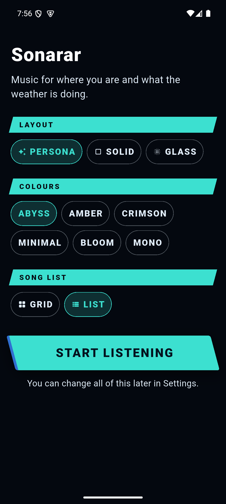
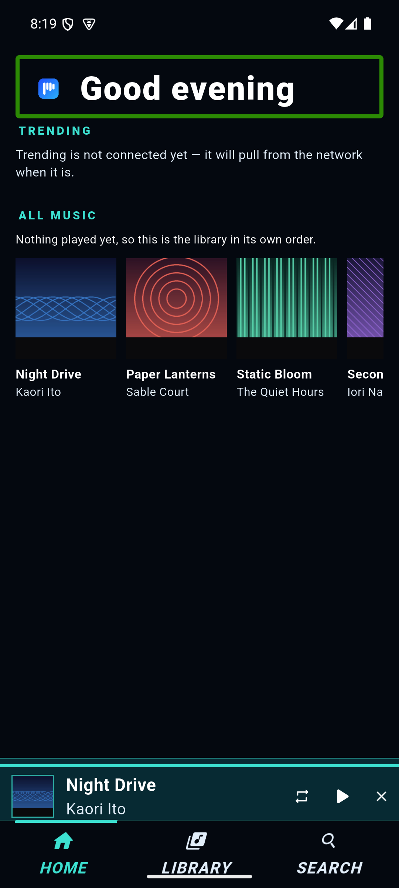
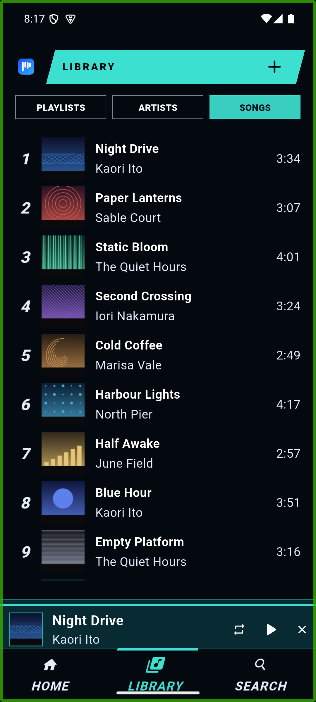
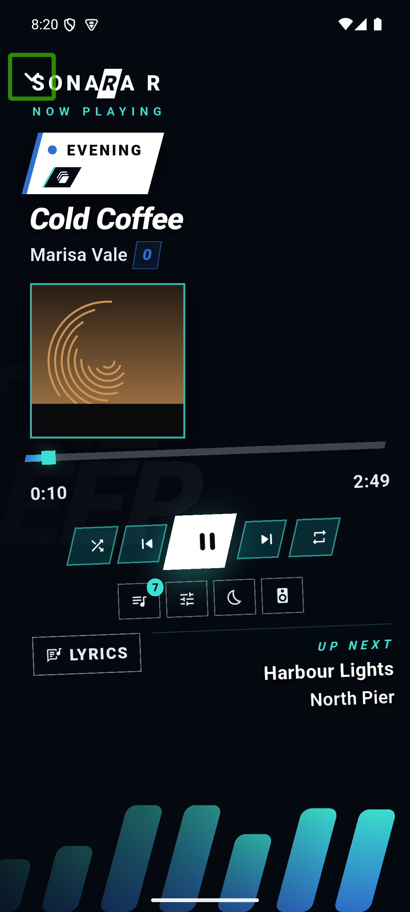
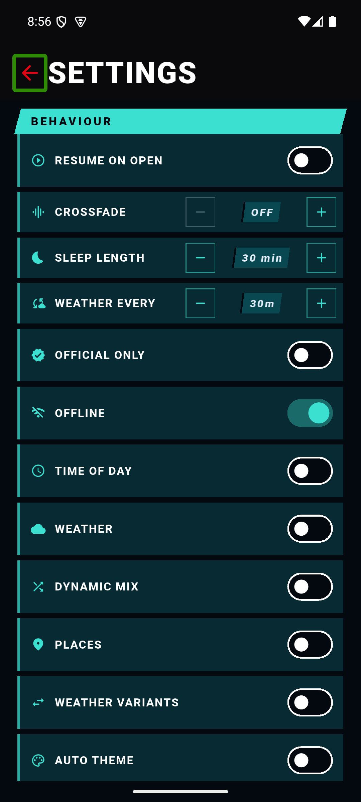

# Sonarar

**A local-first music player for Android.** It plays files you already own, works without a network,
and can shape what it plays around your location, the weather and the time of day.

[](LICENSE)
[](#install)
[](../../releases)

No account. No cloud. No upload. No analytics, no tracking, no advertising.

---

## Contents

- [Overview](#overview)
- [Screens](#screens)
- [Install](#install)
- [First run](#first-run)
- [Features](#features)
- [Context engine](#context-engine)
- [Your library](#your-library)
- [Build from source](#build-from-source)
- [Tests](#tests)
- [Permissions and privacy](#permissions-and-privacy)
- [Project layout](#project-layout)
- [Known limitations](#known-limitations)
- [Licence](#licence)

## Overview

Sonarar is a music player for people who keep their own files. It reads an on-disk library, plays it
through Android's media session, and stays usable in flight mode. The optional part is the context
engine: with it enabled, the queue is built from saved places, a live forecast and the hour of the day.

The context engine is opt-in and off by default. A fresh install behaves like a conventional local
player: the queue is what you choose and the theme stays where you set it.

## Screens

<p align="center">
  
  
  
</p>
<p align="center">
  
  
</p>

Captured from the app running on a 1080×2400 device. The library in them is invented — twelve
generated tracks — because the real one is your own music.

## Install

Download the latest APK from [Releases](../../releases) and open it on the device.

| | |
|---|---|
| Package | `com.noah.sonarar` |
| Version | 0.1.0 (versionCode 11) |
| Minimum Android | 7.0 (API 24) |
| Architecture | arm64-v8a |
| Signing | Signed with the project key; installs directly |

Distribution is a signed APK, not a store listing. An F-Droid build recipe is kept in
[`store/fdroid/com.noah.sonarar.yml`](store/fdroid/com.noah.sonarar.yml) for a build signed by the
store instead.

## First run

The app ships with no content of your own and invents none:

- **No playlists.** You start with an empty list screen rather than a set of folders you did not make.
- **No Home tab.** Home is assembled from what you have played, your playlists and the context engine.
  With none of those it leaves the tab bar and the app opens on **Library**; it returns on its own the
  first time there is something to fill it.
- **No permission prompt.** Nothing is requested until you open the Library, switch on Places, or play
  a track.
- **An empty library**, because the library path is fixed and the manifest is built on a computer. See
  [Your library](#your-library).

## Features

**Playback**
- Local files via `just_audio`, with a media session, lock-screen and notification controls.
- Gapless playback, crossfade in one-second steps up to 12 seconds, sleep timer with fade.
- Queue editing: reorder, remove, play next, shuffle, repeat.
- Per-track bookmarks and loop points.

**Library**
- Playlists: create, rename, reorder, delete; merge two lists with Fusion.
- Browsing by playlist, artist and song, with search and swipe actions.
- Compendium: every track, with how much of it has been heard and when.
- History: listening statistics by day and by time of day.
- Lyrics, with romaji readings for Japanese and Korean tracks.

**Presentation**
- Six skins — Abyss, Amber, Crimson, Minimal, Mono, Bloom — each with its own palette, typography and
  layout.
- Three layout families: Persona, Solid, Glass.
- Animated visualiser driven by per-track spectrum data.

**Network (optional)**
- Weather from Open-Meteo; nearby places from Overpass.
- YouTube playlist download through yt-dlp, into the same library format.

## Context engine

Six behaviours are individually switchable. All of them default to **off**.

| Switch | Effect when enabled |
|---|---|
| **Time of day** | The hour selects the queue and repaints the theme. |
| **Weather** | A live forecast changes what plays; rain has its own lists. |
| **Places** | Saved locations trigger their own playlists on arrival. |
| **Dynamic mix** | The context builds the queue at all; off, only your own lists play. |
| **Weather variants** | A track swaps to its rain or night version mid-queue. |
| **Auto theme** | The skin follows the hour and the weather. |

Three further opt-ins govern what the app records: **Learn from skips** (per-time-of-day acceptance),
**Play history** (the listening log behind History and the Compendium), and **Bonds**, the rank panel
inside History.

Switching **Weather** or **Places** on fetches the reading immediately rather than waiting for the next
refresh interval. **Offline** is a separate master switch that cuts the network for every feature,
downloads included.

## Your library

The app reads `/storage/emulated/0/Music/Sonarar` and the `library_manifest.json` beside it. The manifest
is produced on a computer by the tools in [`tools/`](tools):

```bash
python3 tools/build_library.py     # scan and plan; writes only a report
python3 tools/execute_library.py   # transcode, tag, write covers, manifest and gain
```

Requires Python 3 (standard library only) plus `ffmpeg`/`ffprobe`. Re-running is safe: completed tracks
are skipped. Paths resolve from `--source` / `--project` / `--adb` flags, then `PERSONAR_SOURCE_DIR` /
`PERSONAR_PROJECT_DIR` / `PERSONAR_ADB`, then the user's `Music` folder.

Output layout:

```
Music/Sonarar/
  library_manifest.json     track metadata, covers, gain, loudness
  <Artist>/<Album>/*.opus   audio
```

## Build from source

Requires Flutter **3.47.6** and Dart **3.13.5**. Earlier versions will not compile this project.

```bash
cd app_src
flutter pub get
flutter build apk --release --target-platform=android-arm64
```

Output: `build/app/outputs/flutter-apk/app-release.apk`.

The release build is **unsigned unless a keystore is configured**. Place `android/key.properties`
(gitignored) containing `storeFile`, `storePassword`, `keyAlias` and `keyPassword` to sign it; without
that file Gradle produces an unsigned APK, which is what a store that signs its own builds expects.

`--target-platform=android-arm64` is required in practice. The default build packages three ABIs, and
the two that cannot run on a phone account for the majority of the APK.

## Tests

```bash
cd app_src
flutter analyze --fatal-infos
flutter test
```

Current state: no analyzer findings, **1553 tests** passing across 175 test files.

## Permissions and privacy

No permission is requested at launch.

| Permission | Requested when |
|---|---|
| Location | **Places** is switched on |
| Storage / media | The Library is opened |
| Notifications | First playback |

Declining any of them leaves the rest of the app functional. With Places off the app does not use the
GPS at all.

Network endpoints, none of which carry an account:

| Purpose | Endpoint |
|---|---|
| Weather | Open-Meteo (`api.open-meteo.com`) |
| Coarse position fallback | ipapi.co |
| Nearby places | Overpass API |
| Downloads | YouTube, only on request |

There is no analytics, tracking or advertising code in the build.

## Project layout

```
app_src/                  Flutter application
  lib/
    core/                 app state, preferences, storage
    library/              manifest, playlists, history, compendium
    playback/             loop points, sleep timer
    player/               audio engine, queue, variants
    context/              location, places, weather, POI
    rules/                context rules and selection
    screens/              UI
    theme/                skins, layouts, typography
    widgets/, art/        shared components and artwork handling
  test/                   unit, widget and golden tests
  fastlane/               store metadata and changelogs
tools/                    PC-side library builder and deployment scripts
store/fdroid/             F-Droid build recipe
```

## Known limitations

- **No in-app folder picker.** The library path is fixed and the manifest must be built with the
  tools. This is the main gap for a first-time user, and the next planned feature.
- **Replay gain is measured but not applied.** Tracks carry `gain_db`; playback ignores it.
- **Arrival detection is foreground only.** Screen-off geofencing is not part of this build.
- **Location is a framework reading**, not a background service; the context reports "detected" or
  nothing, never an estimate.

## Licence

GPL-3.0-or-later. The application links `youtubedl-android`, which is GPL-3.0, and that is what makes the
combined work GPL. Third-party notices are in [NOTICE.md](NOTICE.md); the licence text is in
[LICENSE](LICENSE).
