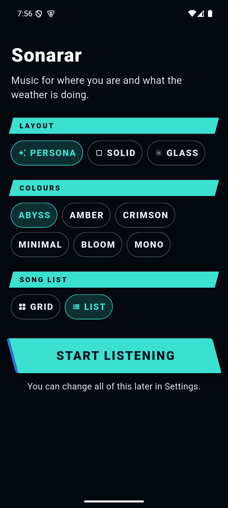
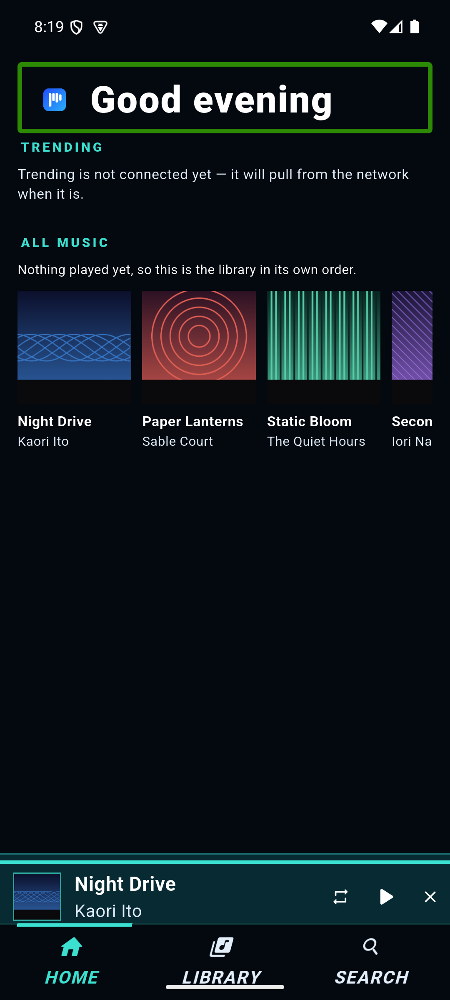
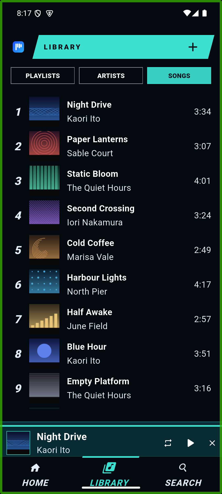
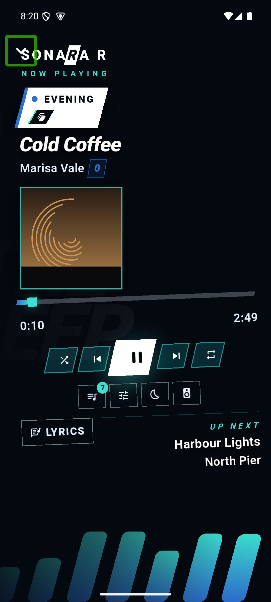
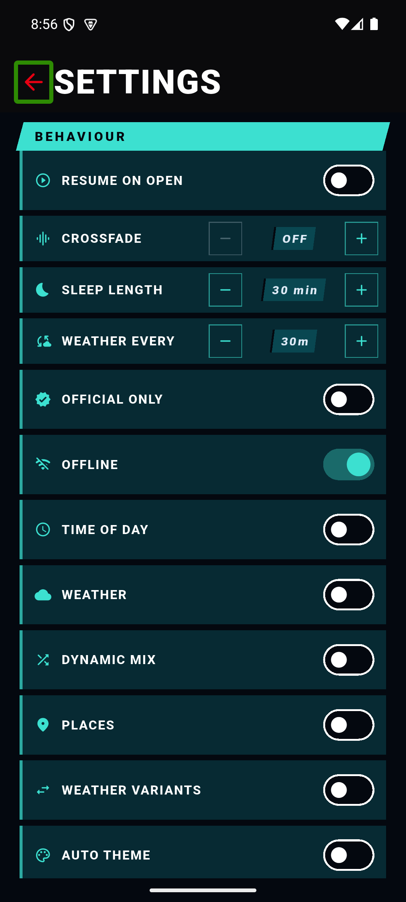

# Sonarar

**A local-first music player for Android.** It plays files you already own, works without a network,
and can shape what it plays around your location, the weather and the time of day.

[](LICENSE)
[](../../releases)

No account, no cloud, no upload, no analytics, no tracking, no advertising.

## Screens

<p align="center">
  
  
  
</p>
<p align="center">
  
  
</p>

Pictured with a generated library. A new install is empty, and stays empty until you point it at
music.

## Install

Take the latest APK from [Releases](../../releases) and open it on the device.

**0.3.6** (versionCode 36) · Android 7.0+ (API 24) · arm64-v8a only · `com.noah.sonarar`

Every release is signed with the same project key, so they install over each other. A 32-bit phone
cannot run it. The [F-Droid recipe](store/fdroid/com.noah.sonarar.yml) is a store-signed build — that
signature is not this one, so it cannot upgrade over a GitHub build.

If a download will not install, check its size first: a 65 MB file that stopped halfway gives the same
"could not parse the package" message as a bad build.

## Getting music onto the phone

The app does not import from the device. The library is built on a PC and pushed in a fixed layout,
which is what makes a large collection cheap to scan and keeps covers, gain and spectrum data beside
the audio.

```bash
python3 tools/build_library.py           # dry run: inventory the PC folder into reports/
python3 tools/execute_library.py --resume  # build audio, covers, gain and the manifest
python3 tools/sync_library.py --check    # show what the phone is missing
python3 tools/sync_library.py            # push only the changed files over adb
```

The app reads `library_manifest.json` from the folder its empty state names. `sync_library.py`
compares sizes, never writes to the PC, and deletes from the phone only with `--prune`. It also carries
`spectrum/<id>.bin`, which is what the visualiser draws.

## Features

- **Playback** — local files through Android's media session with lock-screen and notification
  controls, gapless through one engine queue, a fade-in of up to 12s per track, a fading sleep timer,
  stop-after-this-track, bookmarks and per-track loop points.
- **Queue** — drag to reorder, swipe to remove with an undo, clear upcoming, save the queue as a
  playlist, and play-next that leaves the current track alone.
- **Library** — playlists, Fusion to merge two, browsing by playlist, artist and song, search and swipe
  actions, a compendium that counts what you have heard, history by day and hour, and lyrics with
  romaji readings: full for Korean, kana-only for Japanese, since reading kanji aloud would mean
  shipping a 32 MB dictionary.
- **Look** — six skins (Abyss, Amber, Crimson, Minimal, Mono, Bloom), three layout families (Sonar,
  Solid, Glass), and a visualiser drawn from per-track spectrum data kept beside the audio. A track
  with no spectrum file shows no bars.
- **Languages** — English, Tiếng Việt, Suomi, 简体中文 and 日本語, chosen in Settings or followed from
  the phone. Caps and letter-spacing follow the script, so a caseless language is neither shouted nor
  tracked. Adding one is a single ARB file; [docs/localization.md](docs/localization.md) has the steps.
- **Personalize** — one screen for the whole look: themes, layout, song-list shape, accent, motion,
  the picture behind each place and its framing, art folders, and Home section order. Settings keeps
  behaviour only.
- **Themes own the look** — skin, layout, accent, backdrop, Home order, every per-place picture, the art
  bundle and its framing. Editing anything edits the theme you are wearing, so switching away and back
  returns your version. The file is written once the hand stops moving, not on every tick.
- **Art folders** — a folder of pictures in `Music/Sonarar/art/` becomes a bundle, each picture a frame.
  RESCAN picks up folders added while the app is open; ADJUST drags, zooms, rotates, mirrors or fades
  any picture, and the framing follows that picture everywhere.
- **Optional network** — weather from Open-Meteo, nearby places from Overpass, and YouTube playlist
  downloads through yt-dlp into the same library format.

## Context engine

Six switches, each independent, all off until you turn them on.

| Switch | Effect when enabled |
|---|---|
| **Time of day** | The hour selects the queue and repaints the theme. |
| **Weather** | A live forecast changes what plays; rain has its own lists. |
| **Places** | Saved locations trigger their own playlists on arrival. |
| **Dynamic mix** | The context builds the queue at all; off, only your own lists play. |
| **Weather variants** | A track swaps to its rain or night version mid-queue. |
| **Auto theme** | The skin follows the hour and the weather. |

Three more govern what is recorded: **Learn from skips**, **Play history** (the log behind History and
the Compendium), and **Bonds** (the rank panel inside History). Turning Weather or Places on fetches a
reading immediately rather than at the next interval. **Offline** cuts the network for everything,
downloads included.

## Build from source

Flutter **3.47.6**.

```bash
cd app_src
flutter pub get
flutter build apk --release --target-platform=android-arm64
flutter analyze --fatal-infos && flutter test
```

The APK is unsigned unless `android/key.properties` (gitignored) names a `storeFile`,
`storePassword`, `keyAlias` and `keyPassword`. `--target-platform=android-arm64` is not optional: the
default build packages two more ABIs that no phone runs and that make up most of the file size.

## Updates

Checked once per launch after the first frame, so it never delays startup. Sonarar downloads the APK,
holds it to the `sha256` published in the release notes, deletes it on a mismatch, and hands it to the
system installer — nothing installs silently. F-Droid builds compile the checker out with
`--dart-define=SONARAR_SELF_UPDATE=false`; the store updates the app.

## Privacy

No permission is requested at launch, and declining any of them leaves the app working. Media access
is asked for when the library opens, notifications on the first play. Location is asked for only when
Places is switched on; with Places off the GPS is never touched. The microphone permission exists for
one thing: the spectrum probe attaches a system `Visualizer`, which Android gates behind it. It is
asked for from that probe screen, and playback does not use it.

The build contains no analytics, tracking or advertising. Its only network calls are weather
(`api.open-meteo.com`), a coarse position fallback (`ipapi.co`), nearby places (Overpass), and YouTube
downloads on request. None of them carry an account.

## Licence

GPL-3.0-or-later, because `youtubedl-android` is GPL-3.0. Third-party notices in [NOTICE.md](NOTICE.md),
licence text in [LICENSE](LICENSE).
